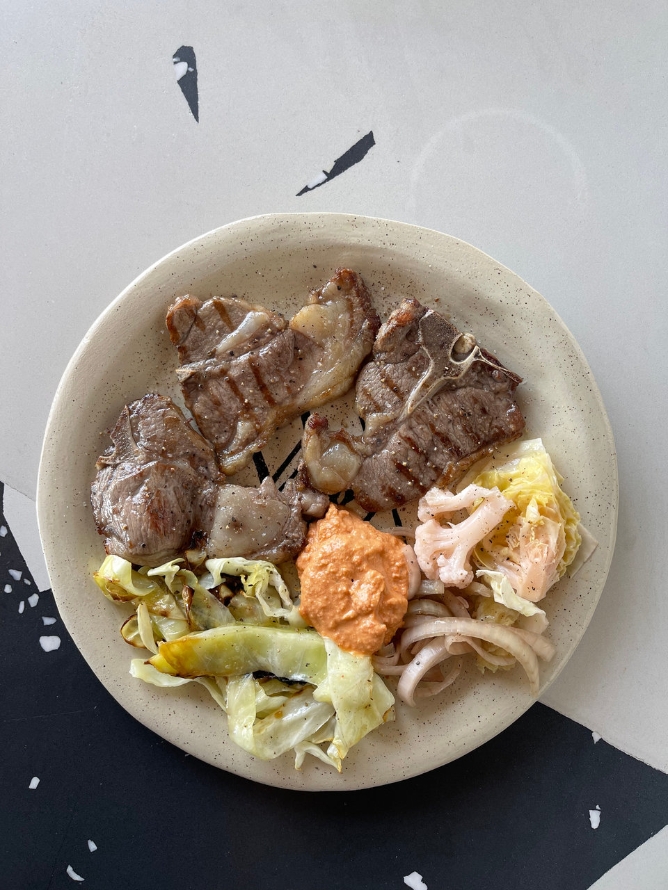

תזונת פליאו Paleo Diet, המכונה גם תזונה פלאוליתית או תזונת האדם הקדמון, היא גישה תזונתית המבוססת על הרעיון כי המזון הנכון ביותר עבורנו הוא מזון שצרכו אבותינו הקדמונים, שהגוף ומערכת העיכול שלנו עדין מתפקדים ופועלים [כבתקופה הפליאוליתית שארכה כ- 2,000,000 שנים והיתה הארוכה ביותר בתולדות האדם](https://he.wikipedia.org/wiki/%D7%94%D7%AA%D7%A7%D7%95%D7%A4%D7%94_%D7%94%D7%A4%D7%9C%D7%90%D7%95%D7%9C%D7%99%D7%AA%D7%99%D7%AA#:~:text=%D7%A0%D7%9E%D7%A9%D7%9B%D7%94%20%D7%9E%2D250%2C000%20%D7%A2%D7%93%2045%2C000,%D7%9E%D7%91%D7%97%D7%99%D7%A0%D7%94%20%D7%90%D7%A0%D7%98%D7%95%D7%9E%D7%99%D7%AA%20\(%D7%94%D7%95%D7%9E%D7%95%20%D7%A1%D7%A4%D7%99%D7%99%D7%A0%D7%A1\).) ואילו בעשרת אלפים השנים האחרונות מאז המעבר לחקלאות מערכת העיכול עוד לא הספיקה להתרגל לשינויים התזונתיים של התקופה החקלאית שתוצריה היו ריבוי דגנים כמו חיטה וקטניות. מה גם, שכל התצרוכת החקלאית ובעיקר החיטה שהאדם גידל אז לא דומים כלל וכלל לדגנים שאנחנו צורכים היום שעברו שינויים והינדוס גנטי.

**וכי התזונה המודרנית המבוססת על מזון מעובד, שמני זרעים, סוכר והרבה מאוד פחמימות היא האחראית העיקרית לתחלואות של ימינו כגון השמנה, לחץ דם, כבד שומני, סוכרת, מחלות אוטואימוניות, מחלות לב, בעיות פוריות, ואף אלצהיימר וסרטן.**

תזונת פליאו מחקה ככל האפשר את התפריט שהיה זמין לאבותינו הציידים-לקטים מהתקופה הפליאוליתית לפני הופעת החקלאות והמזון המעובד.

**תזונת פליאו מבוססת על חומרי גלם טבעיים ונקיים, עדיפות ממקור אורגני: בשר, עוף, דגים, ביצים, מוצרי חלב שמנים (למי שלא רגיש), ירקות, אגוזים, זרעים ופירות.**

**בתזונת פליאו לא צורכים דגנים וחיטה, סוכר, שמן זרעים (קנולה, סויה, חמניות, זרעי ענבים) ומזון מעובד.**

**למה כדאי לצמצם פחמימות ולעבור לתזונת פליאו טבעית?**

קודם כל, כל תזונה באשר היא שתצמצם צריכה של מזון מעובד, מוצרי חיטה, סוכר ושמן זרעים, היא מבורכת!

די מיידי אפשר יהיה להרגיש בשינוי והטבה: הרגשה כללית טובה יותר, ירידת תחושת נפיחות, אנרגיות גבוהות לאורך היום, שינה טובה יותר, מצב רוח מרומם, מראה בריא יותר של העור, שיער והציפורניים, מערכת העיכול תעבוד טוב יותר, חלק מהאנשים יורידו במשקל וכו׳...

למה בנוסף כדאי גם להגביל בפחמימות?

הפחמימות הן תרכובות אורגניות העשויות משלד פחמנים ומכאן נובע שמן. אבני הבניין הבסיסיות מהן בנויות הפחמימות: גלוקוז, פרוקטוז וגלקטוז (סוכרים).

בתהליך העיכול, הפחמימות מתפרקות ליחידות הקטנות המרכיבות אותן - חד הסוכרים, וכך הן נספגות לזרם הדם.

אם הגוף מקבל יותר פחמימות ממה שהוא צריך למען הפקת אנרגיה, הוא אוגר את העודפים כשומן. כמויות הסוכר הגבוהות הנמצאות בדם עקב אכילת כמויות גבוהות של הפחמימות לאורך זמן גורמות לתנגודת האינסולין שהוא שורש מחלות רבות שהתפתחו במאה האחרונה הנקרות ״הסינדרום המטבולי״ Metabolic Syndrome, ובינהן:

לחץ דם, טרשת עורקים, כבד שומני, סוכרת, שחלות הפוליציסטיות, מחלות לב וכלי דם, שבץ מוחי

הגבלת פחמימות בתזונה תוביל לייצור אנרגיה משומנים. במצב זה, השומנים יהפכו בכבד ״לגופי קטון״ שמגיעים לזרם הדם ולרקמות הגוף כמקור אנרגיה זמין. מצב זה נקרא קיטוזיס ובעל מספר רב של יתרונות.

**כמה פחמימות אוכלים בפליאו ואיך נראת הצלחת?**

בתזונת פליאו אוכלים כ- 100 גר׳ פחמימות ליום, כל ארוחה צריכה להיות מורכבת משלושת אבות המזון: שומן, חלבון ופחמימות שמקורן בעיקר מירקות.

כלל נוח לסידור הצלחת הוא ״חצי חצי״ כחצי צלחת צריכה לכלול מזון מהחי (עדיפות שמן כמו בשר עם שומן, ביצים, או סלמון או בתוספת מנת שומן (טחינה, זיתים, אבוקדו, שמן זית) וכחצי צלחת צריכה להיות מורכבת מירקות.

*Paleo plate*

**טיפים למי שמעוניין להתחיל תזונת פליאו:**

-   **אל תפחדו משומן.** שומן ישמור עליכם שבעים ומרוצים. והגוף יאותת לכם אם אכלתם יותר מדיי שומן.
-   **תאכלו רק כשרעבים באמת.** בלי ארוחות ביניים, נשנושים וטעימות בין לבין.
-   **שתו מים!** לפחות 2-3 ליטרים ביום.
-   **תאכלו מספיק ירקות!** אכילת פחמימות גורמת לאגירת נוזלים בגוף ולכן כשמתחילים להוריד את כמויות הפחמימות מתחילים להשתחרר נוזלים מהגוף (אולי תרוצו יותר פעמים לשירותים מבדרך כלל) עם הנוזלים הגוף משחרר גם מינרלים חשובים ולכן חשוב מאוד להקפיד על כמות מספקת של ירקות, בעיקר ירקות עליים ולתסף במלח ים טבעי המכיל מינירלים חשובים (תזרקו את המלח שולחן המעובד).
-   **תאכלו את כל אבות המזון.** תקפידו לאכול בכל ארוחה מספיק חלבון, שומן וירקות.
-   **תאכלו אוכל טבעי ונקי ממקור אורגני.** קיימים לא מעט מוצרים בשוק ״ידידותיים לפליאו״, יש לקרוא בעיון את רשימת המרכיבים ולהימנע מאוכל מעובד ושמנים מזרעים ככל האפשר. מזון שמגיע לא ארוז, כחומר גלם, הוא הכי בטוח!
