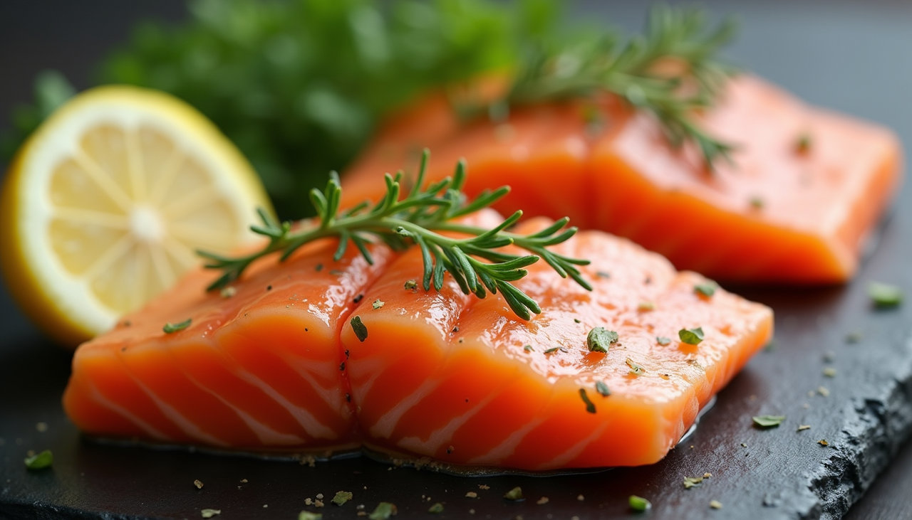
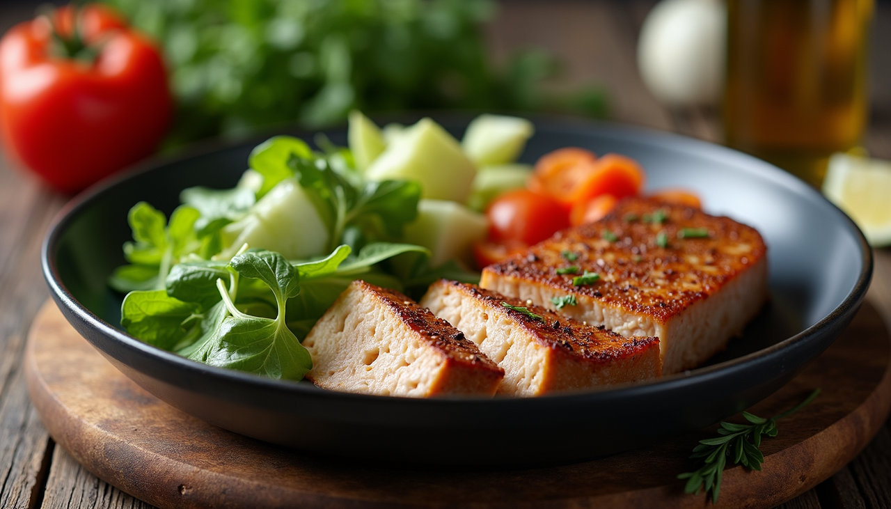

תזונה קטוגנית היא דרך מצוינת לשפר את הבריאות ואת הרגלי האכילה. אם אתם שוקלים להתחיל את התהליך, כדאי להבין את העקרונות הבסיסיים ואת הדרכים לשמור על התזונה הזו בצורה מושכלת. במאמר זה נחלוק טיפים, דוגמאות ואסטרטגיות שיעזרו לכם להתחיל ולשמור על הצלחה בתזונה זו.

## איך להתחיל קטוגני

השלב הראשון להתחלה מוצלחת בתזונה קטוגנית הוא להבין את העקרונות הבסיסיים שלה. מטרה של תזונה זו היא להביא את הגוף למצב של קטוזיס, שבו הוא ישתמש בשומן כמקור אנרגיה עיקרי במקום פחמימות.

כדי להגיע למצב זה, יש להקטין את צריכת הפחמימות ל-20-50 גרם ביום, להשאיר על כנה את צריכת החלבון ולהגדיל את צריכת השומנים. לדוגמה, אכילת אבוקדו, אגוזים, דגים ושמנים בריאים יכולים להיות מוצרים מצוינים בתכנון התזונה.

## מה לאכול בתזונה קטוגנית

ישנם כמה מזונות שאתם יכולים להוסיף לתפריט הקטוגני שלכם. חשוב לכלול קבוצה מגוונת של רכיבים כדי לשמור על רמות חומרים מזינים גבוהות.

בין המזונות המומלצים ניתן למנות:

-   ירקות בריאים כמו ברוקולי, קישואים, וברוקולי.
-   חלבונים כמו ביצים, דגים ובשר רזה.
-   שומנים בריאים כגון חמאת אגוזים, שמן קוקוס ושמן זית.

תבשילו מראש כדי לפשט את התהליך ולהימנע מפיתויים.

*Fresh salmon fillets ready for cooking*

## התמודדות עם קשיים ואתגרים

כמו בכל שינוי תזונתי, ישנם אתגרים שיכולים לעמוד בפניכם. בתחילת הדרך, ייתכן ותיתקלו בתסמינים של "קטו פלוז" - כאבים ראש, עייפות או תסמינים דומים.

לשם כך, חשוב להקפיד על שתייה מרובה של מים ולדאוג לצרוך מנת מינרלים מספקת. ניתן לנסות לשתות מרק ממכיל צורכי מינרלים, כדי להקל על התסמינים.

## שמירה על התזונה האופטימלית

כדי לשמור על דינמיקה חיובית ותוצאות חיוביות בתהליך, יש ליזום שינויים קטנים אך משמעותיים. שקול לדרג את התקדמותך ולשתף אחרים בחוויותיך. זה יכול לשפר את המוטיבציה שלכם להמשיך.

בהתבסס על דוחות מחקר, תכנון תפריט במוקדם יכול לשפר את הצלחה התהליך ב-70%. בהצלחה!

## טיפים להצלחה לטווח הארוך

כדי להצליח בתזונה קטוגנית לאורך זמן, יש להסתמך על מידע, לפרות בין דינמיקות שונות ולחפש דרכים חדשות לשיפור החוויות הקולינריות שלכם.

בעבר, אנשים מצאו כי קריאת ספרי בישול, הצטרפות לקבוצות תמיכה ברשת ומציאת מתכונים חדשים הם דרכים מצוינות להישאר מעודכנים ומעוניינים.

כמו כן, אל תשכחו להקשיב לגוף שלכם ולראות מה מתפקד עבורכם. ההשפעה של תזונה יכולה להיות שונה מפעם לפעם בהגיבות שונות, ואם לא כל מזון עובד עבורכם, אל תהססו לנסות משהו אחר.

*Keto meal placement with prepared ingredients*

## סיכום השיטה והצעדים הבאים

אם אתם מוכנים להתחיל בתהליך ואפילו הייתם בכמה חוויות קודמות, אל תדאגו - לא מדובר בנטישה המטבולית, אלא בהרפתקה חדשה ומלהיבה במזון.

במהלך הדרך, תזונה זו יכולה לשפר בריאות, אנרגיה ורמות תודעה. ניתן להגיע לרמות גבוהות של אושר עם בחירות נבונות ונפלאות בריאות.

לסיום, כדאי לשלב את ["תזונה קטוגנית"](/blog) בחייכם, ללמוד ולהישאר מעודכנים. הגשמת החיים הטובים והבריאות מתחילה בהחלטות הנכונות.
