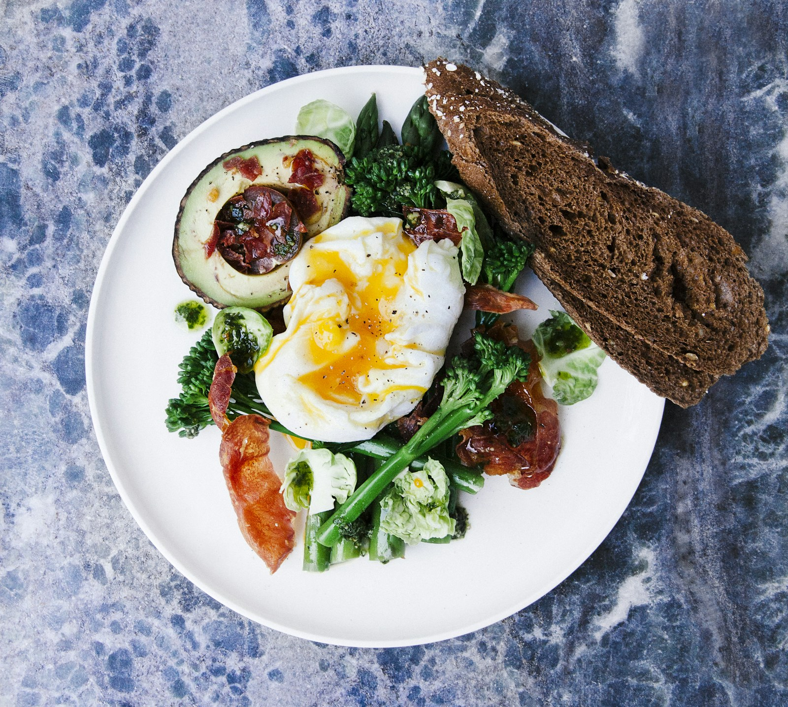
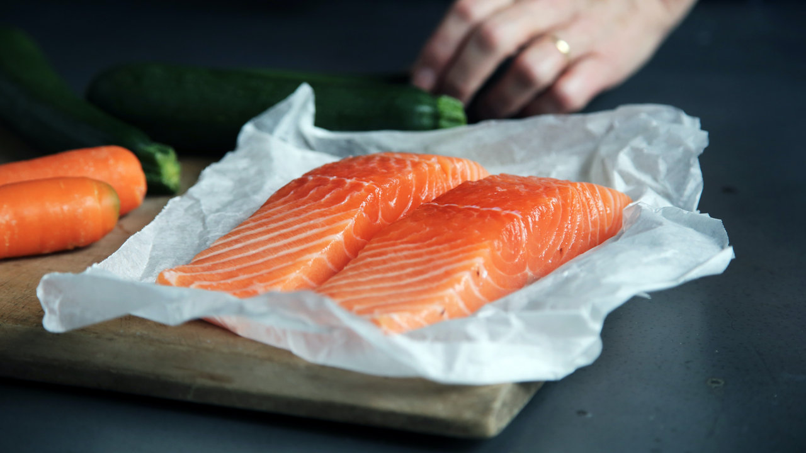
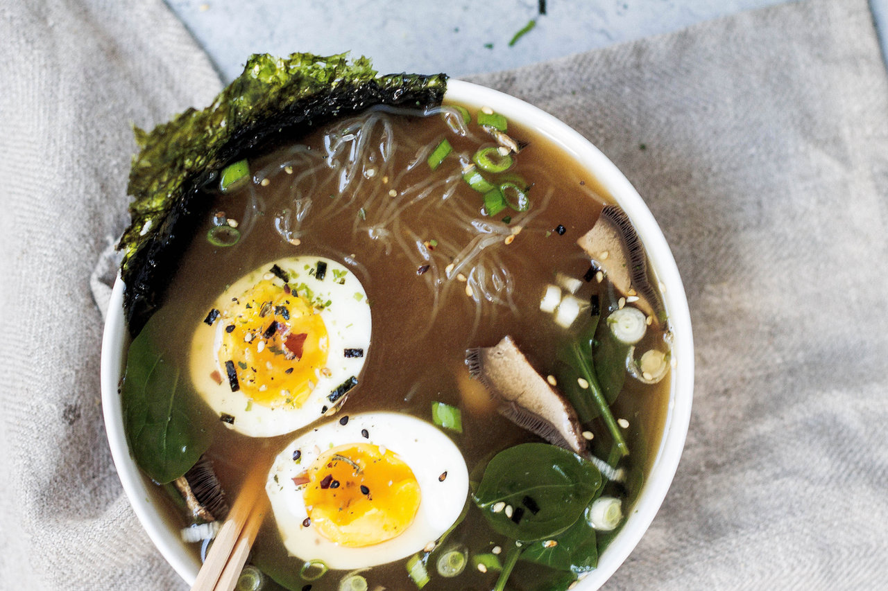

### איך מרכיבים ארוחה?

האמת שזה די פשוט. ואחרי כמה ימים ותרגול זה נהיה זורם וטבעי.

כדאי לעקוב אחרי הצעדים עד שמתרגלים:

1\. נבחר מקור חלבון (בשר, דגים, טופו, ביצים, קטניות פעם בשבוע)

2\. נוסיף לו מנת ירקות (סלט, ירקות צלויים או מאודים, שייק ירוק).

3\. נוסיף שומן ממקור איכותי כמו: שמן זית, טחינה, זיתים, אבוקדו, אגוזים (עד חופן) בשר שמן, ביצה היא גם מקור לשומן וגם לחלבן.

ואפילו קינוח שמן בסוף הארוחה יכול להיחשב כתוספת שומן.

### ארוחות לדוגמא

הסדר לא באמת חשוב.

כל ארוחה ניתן להחליף בארוחה אחרת, כל מנת חלבון ניתן להחליף במנת חלבון באחרת.

בתאבון! 🍳

### ארוחת בוקר

-   [טורטיות מכוסמת ירוקה](/recipes/טורטיות-פליאו-צבעוניות)
-   חביתה (מנת חלבון)
-   גבינת שמנת או טחינה
-   ירקות חתוכים

---

-   יוגורט יווני 10%
-   [שמרים תזונתיים](https://il.iherb.com/pr/kal-imported-nutritional-yeast-flakes-unsweetened-7-8-oz-220-g/70122)
-   פירות יער
-   אגוזים

---

-   חביתה מכמה ביצים שרוצים (מנת חלבון)
-   אבוקדו
-   זיתים
-   ירקות חתוכים/סלט
-   גבינה שמנה / טחינה / חמאה
-   [לחם קטוגני](/recipes/לחם-שקדים)

---

-   [פשטידת כרוב](/recipes/פשטידת-כרוב-נמסה-בפה)
-   סלט / ירקות חתוכים
-   שמנת חמוצה / טחינה / יוגורט יווני
-   ביצים רכות (מנת חלבון)

---

-   [פרצל קטוגני](/recipes/פרצל-קטוגני-רך)
-   חביתה (מנת חלבון)
-   גבינת שמנת / טחינה / חמאה
-   ירקות חתוכים
-   אבוקדו

---

-   סלט ירקות
-   ביצים קשות (מנת חלבון)
-   זיתים
-   [לחם קופים](/recipes/לחם-קופים)

---

-   [קרקרים קיטוגניים](/recipes/קרקרים-גבינה-חלקים-שהילדים-אוהבים)
-   סלט ביצים / סלט טונה (מנת חלבון)
-   אבוקדו
-   ירקות חתוכים

---

-   שקשוקה (מנת חלבון)
-   סלט
-   טחינה
-   זיתים

---

-   [לביבות גבינה מלוחות](/recipes/לביבות-גבינה-מלוחות)
-   גבינת שמנת
-   סלמון מעושן ללא תוספת סוכר (מנת חלבון)
-   ירקות חתוכים

### ארוחת צהריים או ערב

-   [כוס מרק עצם](/recipes/ציר-עצמות)
-   קציצות בשר/סטייק (מנת חלבון)
-   [כרובית בתנור](/recipes/כרובית-אייל-שני)
-   טחינה

---

-   [דג צלוי ברוטב חמאה ועגבניות](/recipes/דג-כל-דג-בחמאה-ועגבניות-שרי) (מנת חלבון)
-   סלט ירקות/חסה

---

-   חציל בתנור עם טחינה
-   ביצה קשה (מנת חלבון)
-   סלט ירקות
-   זיתים
-   [לחם שקדים](/recipes/לחם-שקדים-1)

---

-   חומוס בייתי
-   ביצים קשות (מנת חלבון)
-   סלט ירקות

---

-   [כוס מרק עצם](/recipes/ציר-עצמות)
-   אבוקדו
-   חביתה (מנת חלבון)
-   ירקות חתוכים

---

-   [סלמון מרוקאי](/recipes/סלמון-מרוקאי) (מנת חלבון)
-   סלט
-   קינואה

---

-   ראמן על בסיס [מרק עצם](/recipes/ציר-עצמות) עם ביצה רכה, פטריות, בצל ירוק, בקצ׳וי או כרוב חתוך דק, סקיני פסטה

---

-   ירקות מוקפצים
-   טופו (מנת חלבון)

---

-   [פיצה קטוגנית](/recipes/פיצה-קטוגנית-טעימה)
-   תוספת טונה או בשר טחון (מנת חלבון)
-   ירקות חתוכים

---

-   [קציצות טונה](/recipes/קציצות-טונה-שנזללות-בשניה) (מנת חלבון)
-   ירקות
-   טחינה

---

-   [סביצ׳ה סלמון](/recipes/סביצ-ה-סלמון-סופר-מהיר-וקל) (מנת חלבון)
-   עגבניות שרי
-   אבוקדו

