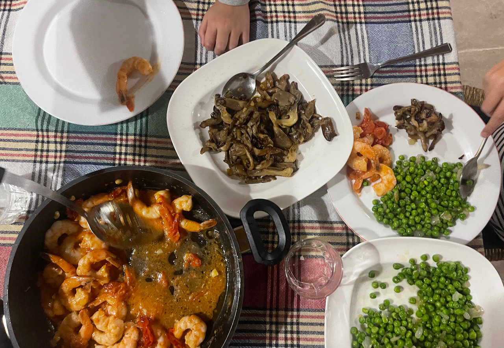
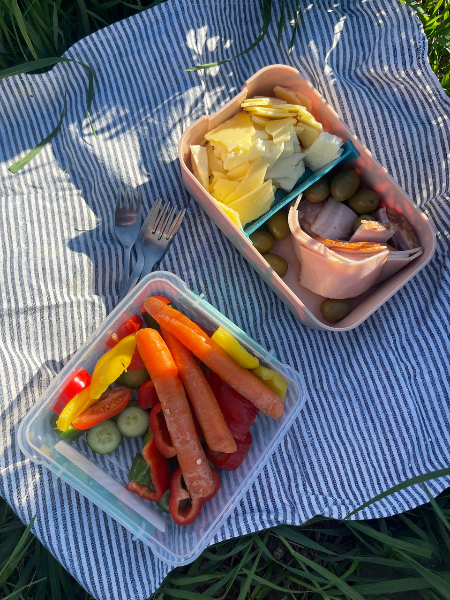
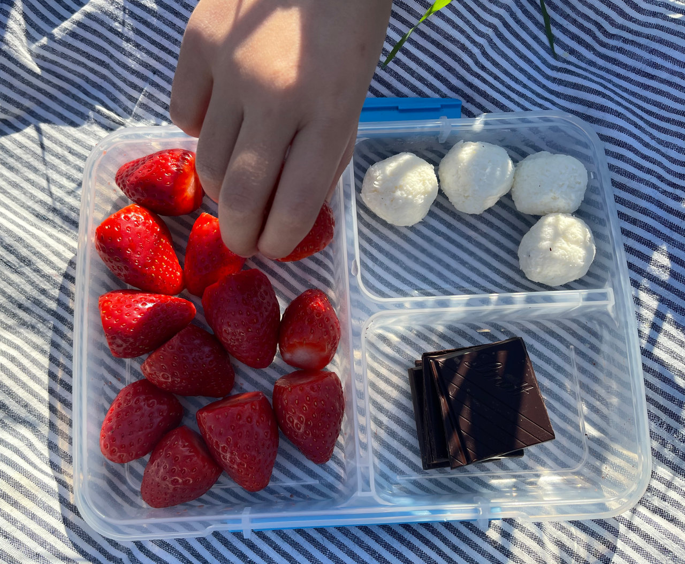
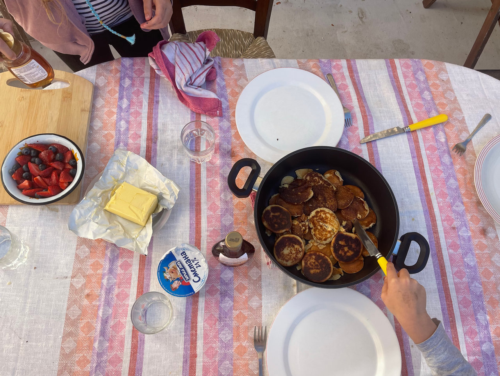
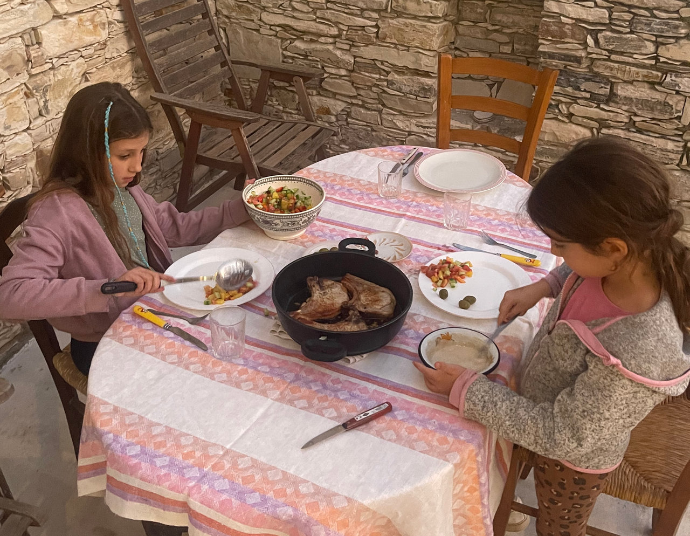
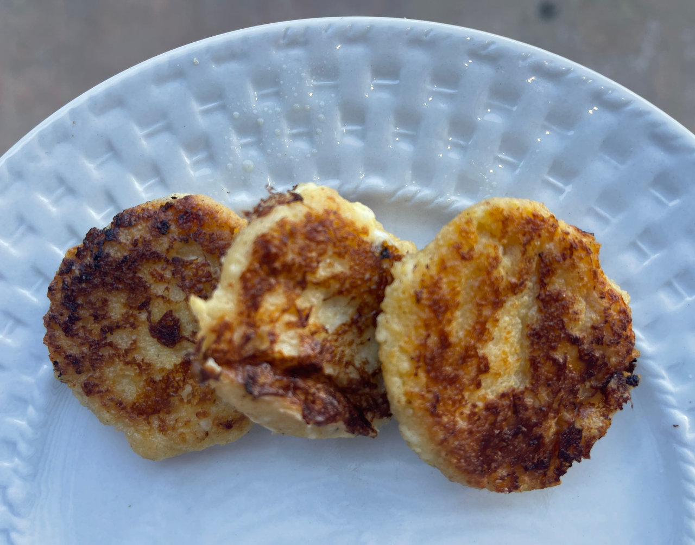
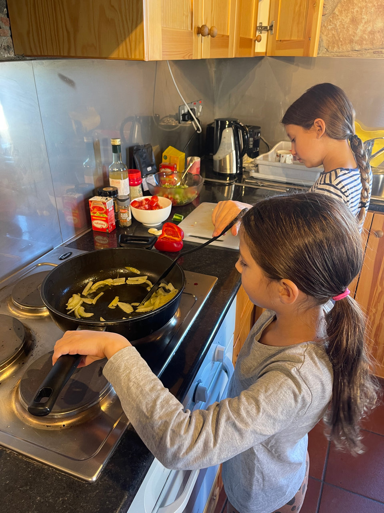

האם כדאי לשמור על תזונה קטוגנית בטיולים וחופשות או לשחרר ולעשות יציאה מודעת?

התשובה היא מאוד אישית כמובן.

השאלה היא איפה אנחנו נמצאים בקיטו. האם רק בהתחלה, האם שומרים כבר תקופה, האם מאוד חשוב לנו להוריד במשקל...

וגם באיזה הרכב נוסעים, לאן, מה התוכנית, האם יש מטבח וכו׳...

קודם כל, למי שרוצה לעשות יציאה מודעת מהתזונה ואז לחזור. תפאדלו! תהנו ותבלו ותתמוגגו על כל ביס של פחמימה!

אשתף את הסיפור והתפיסה של המשפחה שלי ומקווה שזה ייתן רעיונות, כמה טיפים ויפשט את העניין למי שכן רוצה להיצמד לקיטו לפחות בחופשה הקרובה.

אז קצת רקע על משפחת קונצמן-רוזנברג. אנחנו משפחה בת 4 נפשות: אני - אנה, ניצן, שירה בת 6 ורוני בת 9.

בבית אנחנו נצמדים לתזונה קטוגנית 100%. אין סוכר, אין קמח, דגנים, קטניות וכו׳. כמובן שהילדות עוד קטנות ומחוץ לבית אוכלות את מה שהעולם הרגיל אוכל. בתקווה שכשיגדלו יוכלו לבחור בשביל עצמן את האופציה הבריאה והמתאימה ביותר. בבית כמובן אנחנו מדברים על תזונה בריאה. מה בריא ומה לא ולמה והן מאוד בעניין.

בנוסף אנחנו משפחה מטיילת. בגדול רוב הזמן. כמעט ואין סופ״ש ובטח לא חג או חופש שתמצאו אותנו בבית. פשוט לא מוצאים את עצמנו בין 4 קירות.

יש לנו חבר יקר וקטן, ג׳יפ ג׳ימיני שלוקח אותנו לכל מיני מקומות נפלאים כבר כמה שנים. אנחנו נוסעים לטיולי יום, קמפינגים בסופ״שים, עושים חילופי בתים וגם משכירים ומסבלטים את הבית שלנו, מה שמאפשר לנו לטייל יותר. בגלל שאנחנו מטיילים המון אז גם חשוב לנו לעשות את זה בתקציב שפוי (ואם אפשר חינם אז עדיף). פעם בשנה אנחנו כן עושים חופשת נופש מפנקת אבל רוב הזמן מטיילים בטבע אם זה בארץ או בחו״ל, ככה שבגדול צריכים רק מקום בסיסי לישון בו. גם אוהל בא בחשבון אם מזג האויר מאפשר.

מאז שאני בתזונת קיטו אני מאוד משתדלת לשמור גם כשאני מחוץ לבית. פשוט מארגנת לי שימורי טונה, ביצים קשות, ירקות, טחינה ודברים פשוטים שאפשר לקחת. אחרי כמה פעמים זה באמת נהיהי ״לא סיפור״. מאז שניצן הצטרף אליי לתזונה ולמעשה הפכנו את כל הבית ״כשר קיטו״ אז לוקחים את זה איתנו גם מחוץ לבית.

אני יודעת שאנשים עם ילדים חוטפים זיעה קרה רק מהמחשבה שצריך גם לארגן אוכל, לבשל ולהאכיל את כל הפיות. אז פה אני אגיד משהו מתוך הנסיון הבאמת רב של גם טיילנית, גם בשלנית וגם בעלת משפחה (אני אחראית על האוכל בבית. ניצן בתמורה לשירות שוטף ערימות של כלים):

המסקנה שלי אחרי אינספור טיולים וחופשות היא שהרבה פעמים קל יותר להכין משהו מהיר מאשר למצוא מסעדה, לקוות שיש בה מקום, לאכול ברעש (בישראל בדרך כלל), חלק מהמנות הילדים לא יאהבו כי תיבלו את זה לא לטעמם, מרקם מוזר ומי יודע מה עוד. בסוף בדרך כלל מסיימים בפסטה או המבורגר עם צ׳יפס שהוא לא באמת צ׳יפס אלא אבקה טחונה וקפואה ומתבאסים ששוב אכלנו ג׳אנק. ועוד שעה יגיע איך לא ״אמא, אני רעב״. פלוס הוצאנו לא מעט כסף ואם מטיילים כל סופ״ש והרבה יותר אז זה כבר נהיהי עניין כלכלי לא זול בכלל.

אם להניח רגע את הקיטו בצד. בסוף, יותר קל להעמיד סיר פסטה פשוטה, שקשוקה או סיר אורז וסלט. יותר מהר, יותר קל, כולם יאכלו והכל הרבה יותר רגוע.

ובגדול. אני תמיד בעד יותר רגוע.

גם בחו״ל החוויה די דומה. למצוא מסעדה סבבה, שנמצאת במסלול שלכם (בהנחה ואתם לא בעיר) ופתוחה בשעה שאתם רוצים לאכול (כל מדינות הסיאסטה למשל יש להם שעות פתיחה מוזרות וכמה וכמה פעמים נפלנו עם העניין הזה) ובסוף, בואו נודע על האמת, אם זה לא איטליה, האוכל כנראה לא יהיה להיט.

באיטליה אגב, אני לגמרי בעד להתמסר לפחמימות! פסטה, פיצה ואם אפשר גם לקנח באיזה ג׳אלדו! יאם!

אז כמו שאמרתי קודם. אני בעד רגוע. לארגן ארוחה במקסימום חצי שעה. לשבת ברוגע ולאכול ארוחה משפחתית בלי המולה ועניינים. אוכל פשוט שכולם אוהבים וגם נצא מבסוטים שהילדודס קיבלו מנה מזינה ולא סתם דחפנו להם ג׳אנק בשביל לסתום את הרעב ולהמשיך הלאה.

יש לי לא מעט נסיון במטבח, הרבה לפני שהפכתי לקטוגנית. הנסיון והאהבה לאוכל מאפשרים לי להיות יצירתית, אני מאלה שיכולה לארגן ארוחה טעימה ״משום דבר״.

עם המעבר לקיטו וצמצום של החומרי גלם והאפשרויות במטבח גיליתי שדווקא הצימצום מאוד מקל ומפשט דברים. בסופו של דבר החומרי גלם כל כך איכותיים וטעימים שאין באמת צורך באיזה ורטואוזיות קולינרית מטורפת. הפשטות עבדה לטובתי ולהפתעתי אפילו פינתה לי לא מעט זמן במטבח וגם הפכה את הטיולים שלנו לפשוטים יותר והכי חשובים: ר ג ו ע י ם.

אז איך עושים את זה נכון?

קודם כל כמו בכל דבר: התכוונות, תכנון וגמישות.

נתחיל מהפשוטים יותר: התכוונות. כמו שהיא. אנחנו בהתכוונות להמשיך להנות מאוכל מזין גם בחופשה או הטיול שלנו. זוהי נקודת ההתחלה.

גמישות: גם זה פשוט. להיות גמישים ולזרום: אם הילדים ממש רוצים גלידה או שלא הסתדר לכם משהו עם השעות ולא נערכתם בהתאם. אז שחררו, ותאכלו את מה שיש. הכל ממש בסדר.

ולגבי התכנון: גם פה כמה דברים פשוטים שכדאי לבדוק וליישם. ההמלצות הם לטיולים יחסית ארוכים (של יותר מסופ״ש ארוך) בחו״ל אבל תופסים גם לטיולים בארץ.

1.  להזמין מקומות שיש בהם מטבח. אנחנו בדרך כלל מזמינים דרך airbnb או booking. בתים/צימרים/דירות. אני מוודא שיש מקרר, כיריים, כלי בישול ואם יש טוסטר או תנור אז בכלל תענוג. זה מאפשר לנו לאכול בבית שישנים בו או להיערך לפיקניק. בהמשך אפרט דוגמאות לארוחות מהירות או קופסאות פיקניק שלקחנו איתנו לטיולים.
2.  לעשות קניות בסופר גדול. אני תמיד מתכננת שכבר ביום הראשון במידה ונוחתים מוקדם או ביום השני לעשות עצירת קניות בסופר (עדיף אחד רציני עם מבחר גדול). אני מבררת מראש איפה יש באיזור או במסלול הנסיעה ומסמנת על המפה. את [רשימת הקניות](/blog/רשימת-קניות-לטיול-קטוגני) אני מתכננת מראש. היא צריכה לכלול מצרכים לארוחות בוקר/ ערב ופיקניקים מהירים וארוחות צהריים יותר מושקעות שדורשות כיריים כמו בשר/דגים/שרימפס...
3.  להביא או לקנות קופסאות אוכל שישמשו לפיקניקים או לשאריות אוכל שבישלנו ונשאר.

זהו פחות או יותר. מטבח, קניות מרוכזות בסופר לכמה ימים וקופסאות אוכל שנקח איתנו לטיולים.

את הארוחות בטיולים אני מתכננת ומקפידה שיהיו כמה שיותר פשוטות, מהירות וטעימות.

זה משחרר המון מתחים, דאגה וזמן. וגם הכי כיף להכין משהו מהחומרי גלם המקומיים. זה מאפשר לנו להתרכז בטיול עצמו ופחות בלוגיסטיקה. כמובן שאנחנו גם אוכלים במסעדות אבל זה ממש חלק מהתכנון וההנאה. ללכת לארוחת ערב משפחתית במסעדה שווה זה הרבה יותר שווה מלאכול בסתם מקום שמצאנו כי היינו רעבים והיה צריך לסמן וי.

זהו, מקווה שעזרתי ופישטתי כמה דברים. כמו כל דבר, הכל זה תרגול. אחרי כמה פעמים אתם תדעו כמה זמן לוקח לכם להכין כל דבר, מה הילדים שלכם אוהבים יותר ומה פחות, איזה כמויות לקנות בסופר, מה כדאי לארוז לפיקניק וכו׳

מאחלת לכם טיולים רגועים וטעימים!

ארוחת ערב: שרימפס בחמאה ועגבניות שרי, אפונה ירוקה קפואה עם בצל מטוגן, פטריות מטוגנות בחמאה, בצל ושום

פיקניק: קופסת ירקות, קופסת נקניקים, גבינות וזיתים

קינוח בפיקניק: כדורי קוקוס, שוקולד מריר ותותים

ארוחת בוקר: פנקייק קטוגני

ארוחת צהריים: צלעות חזיר בדבש במחבת, סלט ירקות וטחינה

ארוחת בוקר: לביבות גבינה

מכינות שקשוקה
