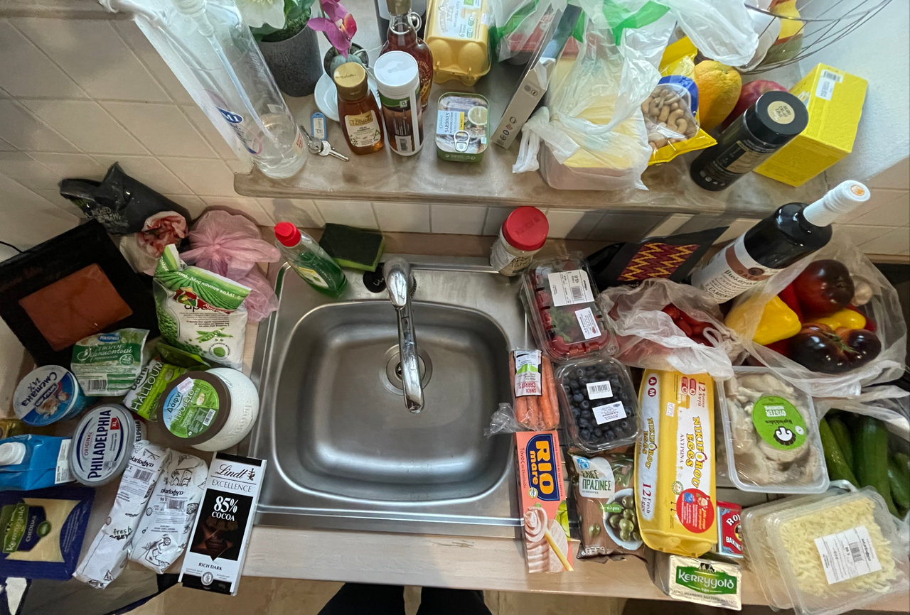
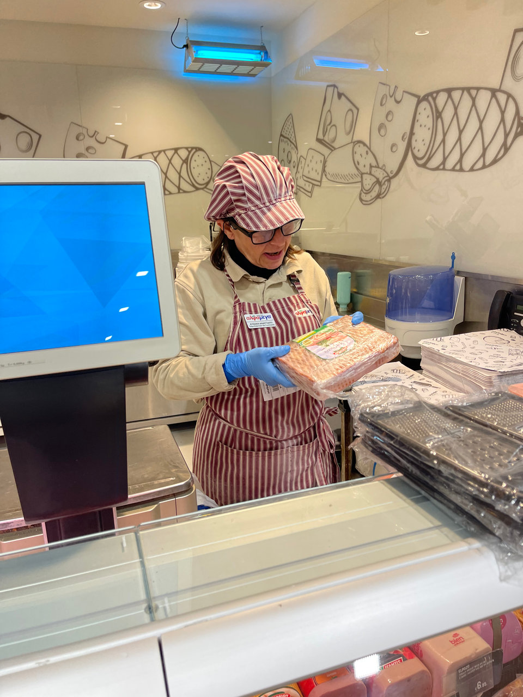

רשימת קניות קטוגניות מומלצות כשאתם בטיולים של כמה ימים ורוצים לשמור על התזונה. את הממתיק כדאי להביא מהבית כי לא בכל מקום יש.

עגבניות

מלפפונים

פלפלים

חסה

כרוב

גזר

בצל

שום

כרובית

חציל

פטריות

פירות יער קפואים או טריים

אגוזים

שוקולד מריר

טחינה

שמן זית

זיתים

טונה בשמן זית

עגבניות מרוסקות

קמח שקדים

אבקת אפיה

מלח אטלנטי/הימלה

יין יבש

חמאה

יוגורט שמן

שמנת מתוקה

מוצרה/צהובה מגורדת

גבינת שמנת

גבינות קשות

ביצים

נקניקים בלי סוכר ובלי חומרים משמרים (אם יש)

אפונה ירוקה קפואה

שרימפס קפוא

סלמון

סטייקים דקים שאפשר להכין במחבת

מי ששומר תזונת פליאו יכול להוסיף:

מייפל/דבש

שיבולת שועל

ירקות שורש

משגעת את המוכרת במעדניה שתבדוק שברכיבים אין סוכר
